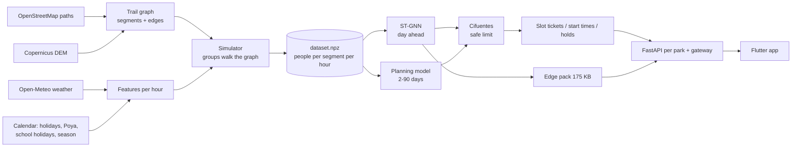

# Component 4 – Complete guide: use it, test it, understand it

Crowd forecasting and crowd control for hiking trails, at Horton Plains and Adam's Peak (Sri Pada).
Written 20 Oct 2026. Sections:
1. [What the system does](#1-what-the-system-does-in-one-page)
2. [Start it](#2-start-it)
3. [Use it, role by role](#3-use-it-role-by-role)
4. [Test it](#4-test-it)
5. [How it works](#5-how-it-works)
6. [How it was developed](#6-how-it-was-developed)
7. [Where everything is](#7-where-everything-is)
8. [Questions examiners are likely to ask](#8-questions-examiners-are-likely-to-ask)
9. [Glossary](#9-glossary)

Short version of the run steps and the fixes for common errors: `RUN_APP.md`.

---

## 1. What the system does, in one page

**The problem.** Horton Plains limits visitors with one fixed number per day (a static DWC quota). Adam's Peak
has no limit at all. Neither knows *where* on the trail people bunch up, or *when*. There are no counts per trail
section and no sensors on the trails.

**What Component 4 does:**

| Step | What | Where in the code |
|---|---|---|
| 1 | Turn open data into a **trail graph**: OSM paths cut into ~300 m (Horton) / ~500 m (Adam's Peak) segments, with slope, wetness, walking time, weather and calendar | `src/data/` |
| 2 | Make a **training target**, because no real counts exist: a simulator walks every hiker group through the graph, hour by hour, for 2022–2025 | `src/sim/simulator.py` |
| 3 | **Forecast** people per segment per hour for tomorrow with a **Spatio-Temporal Graph Neural Network (ST-GNN)**; plus a 2–90 day planning outlook | `src/models/`, `src/planning/` |
| 4 | Turn the forecast into a **safe limit** per trail and day (Cifuentes PCC → RCC → ECC) | `src/capacity/cifuentes.py` |
| 5 | Turn the safe limit into **decisions**. Horton Plains: timed tickets per trail and 30-min slot. Adam's Peak: recommended start times and holds at halfway checkpoints | `src/control/` |
| 6 | Serve everything through an **API** and a **Flutter app** for visitors, pilgrims, rangers and officers. Tomorrow's forecast can also be **computed on the phone, offline** | `src/api/`, `lib/features/component_4/` |
| 7 | **Evaluate** it as research: RQ1–RQ7 | `src/run_benchmark.py`, `src/eval/`, `docs/evaluation_results.md` |

**Two parks, one code base.** Each park is one YAML file (`configs/default.yaml` = Horton Plains,
`configs/parks/adams_peak.yaml`). The environment variable `C4_PARK` picks the park.

---

## 2. Start it

Two terminals in VS Code (PowerShell).

**Terminal 1 – park servers**
```powershell
cd D:\Documents\SLIIT\Research\Decentralized-Hiking-AI\research\component_4
.venv\Scripts\python.exe -m src.live.refresh                                   # Horton Plains, ~1–2 min, once a day
$env:C4_PARK = "adams_peak"; .venv\Scripts\python.exe -m src.live.refresh; Remove-Item Env:C4_PARK
.venv\Scripts\python.exe -m src.api.serve_all                                  # wait for "Uvicorn running"
```
Check: http://localhost:8000/parks lists both parks. Interactive API documentation for one park:
http://localhost:8101/docs (Horton Plains) and http://localhost:8102/docs (Adam's Peak).

**Terminal 2 – the app**
```powershell
cd D:\Documents\SLIIT\Research\Decentralized-Hiking-AI
flutter run -d chrome --dart-define=C4_API=http://localhost:8000
```
`r` reload · `R` restart · `q` quit. If `flutter` is not recognised, close all VS Code windows and reopen. Or, for
one terminal: `$env:Path += ";C:\Users\Jhonny\dev\flutter\bin"`.

**Staff accounts** (once per park; the password is typed and must be at least 10 characters):
```powershell
.venv\Scripts\python.exe -m src.api.users add --username officer1 --role officer
.venv\Scripts\python.exe -m src.api.users add --username ranger1 --role ranger
$env:C4_PARK = "adams_peak"; .venv\Scripts\python.exe -m src.api.users add --username officer1 --role officer; Remove-Item Env:C4_PARK
```

**"Today" in the app** is the date of the last `refresh`. Demo dates below assume the refresh of 20 Oct 2026.

---

## 3. Use it, role by role

### 3.1 Visitor – Horton Plains
1. **Plan your visit → Where to?** Every destination with its next 7 days; the quietest day is marked. Filter
   chips: National park / Pilgrimage. 文A switches English / සිංහල / தமிழ்.
2. **Horton Plains National Park → Plan & book.** A 90-day calendar: green = quiet … red = very busy.
3. Tap **Tue 24 Nov 2026** (Il Poya). The day screen shows:
   - **Expected crowd** with a range (P10–P90) and how confident it is.
   - **Safe limit for this day**, per trail: *expected / safe*. The bar turns red when more people are expected
     than is safe. **Why this limit?** explains each factor: rain, wet ground, crowding, trail condition.
   - **Want a quieter visit?** Another trail, a later start, or another day, with how many fewer people.
4. Pick a trail, group size and entry time (`07:00 · 20 left`) → **Book** → a QR ticket with an 8-letter code.
   **My tickets** shows it again, also offline.
5. **Tomorrow (the on-device forecast).** Tap **tomorrow's** date (21 Oct). The card **"Forecast made on this
   phone"** lists the three busiest trail sections and their peak hour, and how long the forecast took on *this*
   device. The ST-GNN ran inside the app, not on the server.
   - **Test it offline:** open tomorrow once (the pack is stored), stop Terminal 1 (`Ctrl+C`), go back and open
     tomorrow again. The card is still there, with an **offline copy** chip. The rest of the screen needs the
     server, so it shows an error; that is expected.
6. **Map**: the three trails, viewpoints and the trailhead.
7. **Crowding** (bottom bar):
   - **Map:** every trail section coloured by how full it will be tomorrow at the hour you choose;
   - **Safe numbers:** the safe number per trail and the section that sets it;
   - **Your walk:** a suggested start time, direction or trail that avoids the busy sections. Each phone draws a
     different good option (RQ8).

   It all works offline from the forecast pack.
8. **Offline-first:** everything you opened once while online also opens in airplane mode, with a dark
   "Offline" bar. Booking needs a connection.

### 3.2 Pilgrim – Adam's Peak (no tickets)
1. Choose **Adam's Peak (Sri Pada) → Start times.** The season calendar.
2. Tap **Fri 25 Dec 2026** (very busy) and pick a route (e.g. Nallathanniya / Hatton). You see:
   - sunrise at the summit for that date;
   - the **best start**, e.g. 23:30 *the evening before*;
   - how long the climb takes with that night's crowd, with a warning to arrive early;
   - the good start times;
   - the **evening plan**: start the evening before, rest at the halfway hall, leave at the given time;
   - expected wait near the top for each start time.
3. Compare with **Tue 10 Nov** (quiet): the best start is around 02:30 and the climb is much shorter.
4. **Map**: four routes, starts, halfway checkpoints, summit. The dashed line is the approximate last part,
   which is missing in OpenStreetMap.

### 3.3 Ranger – Horton Plains gate (top right **Staff** → `ranger1`)
1. **Now** → set a demo time near a booked slot (e.g. 24 Nov 2026 07:00). Tickets are valid from 15 min before
   to 15 min after their slot.
2. **Check in**: type the code (or scan the QR) → green tick; a second try says "checked_in".
3. **Walk-ins**: sell the places left for visitors without a booking.
4. **Live**: traffic lights per section, estimated from who went through the gate (no sensors).

### 3.4 Park officer – Horton Plains (`officer1`)
1. **This week**: the next 7 days and their bookings. **Refresh now** reruns the daily refresh.
2. **Trail condition**: choose trail, days and Good / Muddy / Partly closed / Closed. The safe limit and the
   tickets for those days change at once; bookings now over the limit are listed. Visitors see the condition.
3. **Close trail**: date, time window and reason. Affected bookings are listed (never cancelled automatically).
4. **Alerts**: slots with more bookings than is safe after the weather got worse, a condition or a closure.

### 3.5 Halfway officer – Adam's Peak (Adam's Peak → Staff → an Adam's Peak account)
1. **Now** → 23 Dec 2026 02:00.
2. **My checkpoint** → enter people who passed in the last 10 minutes (e.g. +100 five times = 500) → **Record**.
   Demo time moves on 10 minutes each time.
3. After two or three counts of 500 the card turns **red: HOLD**, with how many to release per 10 minutes.
   The final steps take ~250 people per 10 min.

### 3.6 Adam's Peak officer
1. **Tonight**: HOLD / NORMAL for the mountain and each checkpoint, latest counts, warnings when a holding
   checkpoint has not reported.
2. **Season**: each of the next 90 nights is *Checks needed*, *Stand by* or *Normal*. Try 25 Dec 2026.
3. Tap a night → **Night plan**: expected wait through the night (likely and busier case), hold windows,
   release rates, the start times given to pilgrims.

---

## 4. Test it

### 4.1 Automated tests (run all three before every commit)
```powershell
cd D:\Documents\SLIIT\Research\Decentralized-Hiking-AI\research\component_4
.venv\Scripts\python.exe -m pytest -q                    # 65 passed, 5 skipped (~2 min)
cd D:\Documents\SLIIT\Research\Decentralized-Hiking-AI
flutter test test/component_4                            # 24 passed
flutter analyze lib/features/component_4 test/component_4   # No issues found
```
The 5 skipped Python tests need data that is not built on every machine (they skip with a reason).

| Test file | What it proves |
|---|---|
| `tests/test_pipeline.py` | Graph is connected; visitors add up; nobody on a trail when closed; **splits do not overlap**; **scalers use the training period only**; unsensed segments give no history; output shape; same seed → same result |
| `tests/test_planning.py` | Outlook uses **no information from after the issue date**; fitted on training years only; suggestions never exceed the alternative's capacity |
| `tests/test_control.py` | Slot plan never exceeds capacity; no tickets after last entry; rain lowers tickets; cannot overbook; walk-in share kept |
| `tests/test_live.py` | Freeze rule; closures; trail condition and wet ground lower the limit but keep bookings |
| `tests/test_api.py` | Public endpoints; booking flow; full slot → alternatives; **roles enforced**; gate check-in; safe limit and conditions; **lockout after 5 failures**; passwords not stored in plain text |
| `tests/test_adams_peak.py`, `test_api_adams_peak.py` | Routes reach the summit; queue forms on busy nights and halfway checks move it; sunrise per date; advice follows the crowd; gateway; no tickets at a pilgrim site |
| `tests/test_edge.py` | The phone pack rebuilds the model's exact inputs; rounded weights give the same forecast; API serves the pack (< 400 KB) |
| `tests/test_field_validation.py` | Counting sheet → pairs → criteria A1–A3; unknown places are explained |
| `tests/test_dashboard.py` | Streamlit research dashboard pages render |
| `test/component_4/c4_test.dart` | Widget tests for every screen: booking, safe limit, trail condition, start times, halfway hold, **on-device forecast offline** |
| `test/component_4/edge_forecaster_test.dart` | The Dart ST-GNN gives PyTorch's answer (< 0.01 people), in < 2 s; wrong pack versions are rejected |

Run one file: `.venv\Scripts\python.exe -m pytest tests/test_edge.py -q`.

### 4.2 Manual test checklist (with the app running)

| # | Do | Expected |
|---|---|---|
| 1 | Open http://localhost:8101/health | `{"ok":true}` |
| 2 | Day screen for a rainy-forecast day vs a dry one | Safe limit lower on the rainy day; "Why this limit?" names rain / wet ground |
| 3 | Officer sets World's End loop to **Muddy** for a day | Safe limit for that trail drops at once; visitors see "Muddy"; alerts list over-limit slots |
| 4 | Book until a slot is full | The app offers a later slot, another trail or another day |
| 5 | Check in the same code twice | Second time: "checked_in" |
| 6 | Check in 1 h before the slot | "Too early" |
| 7 | Ranger tries an officer page via the API (`/admin/alerts` with a ranger token) | 403 |
| 8 | 5 wrong passwords | Account locked for 15 min |
| 9 | Tomorrow's day screen, then stop the server, open again | "Forecast made on this phone" + "offline copy" |
| 10 | Adam's Peak, 25 Dec vs 10 Nov | Busy night: start the evening before; quiet night: start around 02:30 |
| 11 | Halfway: record 500 three times | HOLD + release rate |
| 12 | Switch to සිංහල / தமிழ் | All visitor screens translated (drafts) |

### 4.3 Test the API by hand
Open http://localhost:8101/docs → pick an endpoint → **Try it out** → **Execute**. Useful ones:
`GET /forecast/tomorrow`, `GET /capacity/2026-11-24`, `GET /slots/2026-11-24`, `GET /edge/pack`,
`GET /advisory/2026-12-25` (on 8102). Staff endpoints need **Authorize** with the token from `POST /auth/login`.

### 4.4 Reproduce the research results
All commands from `research/component_4`. Each run writes `results/<park>/<timestamp>_<name>/` with the config,
seed, git hash, metrics and a log. Adam's Peak: put `$env:C4_PARK = "adams_peak";` in front.

| RQ | Command | Time (CPU) | Key output |
|---|---|---|---|
| Data | `python -m src.data.build_dataset` | ~1 min (+ downloads first time) | `data/processed/dataset.npz` |
| RQ1 | `python -m src.run_benchmark` (or `--quick` to check the pipeline) | hours | `metrics_temporal.csv`, `metrics_spatial.csv`, `stats.json` |
| RQ1 (3 seeds) | `python -m src.run_benchmark --protocol temporal --models lstm stgnn stgnn_lstm --seeds 42 43 44 --tag p04` | ~3 h | as above |
| RQ2 | `python -m src.eval.transfer` | ~2 h | `metrics.csv`, `tests.json` |
| RQ3 | `python -m src.control.evaluate_forecast_value` (Adam's Peak) | ~30 min | `summary.csv`, bootstrap intervals |
| RQ4 | `python -m src.control.evaluate_advisory --sweep` (Adam's Peak) | ~30 min | `sweep.csv` |
| RQ5 | `python -m src.pretrain.traffic` then `python -m src.eval.pretrain_transfer` | ~1 h + ~5 h | `metrics.csv`, `tests.json` |
| RQ6 | `python -m src.edge.export` | 2 min | `metrics.json` (latency, memory, int8) |
| RQ7 | `python -m src.eval.field_validation data/field/horton_plains/*.csv` | seconds | `report.json` (A1–A3) |
| Slides | `python -m src.report.slides` | 1 min | `docs/slides/PP1_Component4.pptx` |

Traffic data for RQ5 (`data/external/traffic/metr_la.h5`, `pems_bay.h5`, `distances_*.csv`) comes from the
Hugging Face dataset `TorchSpatiotemporal/ProcessedDatasets` (folder `traffic`). It is not in git.

---

## 5. How it works

### 5.1 The whole pipeline


### 5.2 Data (`src/data/`)
- **Graph** (`graph.py`): downloads paths inside the park's bounding box with OSMnx. Keeps the shortest paths that
  join the points of interest in each route (e.g. entrance → Mini World's End → World's End → Baker's Falls →
  entrance), cuts them into ~300 m segments and links neighbouring segments. A **node of the GNN is a segment**.
  Road links (e.g. the 4.2 km drive to the Thotupola trailhead) get a weaker edge (0.5).
- **Terrain** (`terrain.py`): Copernicus GLO-30 DEM. Per segment: slope (capped at 25 %), **TWI**
  (topographic wetness index: where water collects, i.e. mud), and **Tobler walking time**. Adam's Peak adds stair
  speeds.
- **Weather** (`weather.py`): hourly rain, temperature, humidity, cloud and wind from the Open-Meteo archive
  (ERA5-based); 16-day forecast in live mode; "typical weather" (climatology) beyond that.
- **Calendar** (`calendar_features.py`): weekends, Sri Lankan public holidays, **Poya days** (estimated after 2026,
  62/62 within a day), long weekends, school holidays, pilgrimage season (Dec–May).

### 5.3 The simulator – the training target (`src/sim/simulator.py`)
No one counts people per trail section in Sri Lanka, so the target is simulated, with every assumption written
down (`docs/assumptions.md`, `assumptions_adams_peak.md`):
1. **Daily demand** = 450 × day-of-week × holiday / Poya / long weekend / school holiday × month ×
   rain-in-the-morning × noise.
2. Demand → **groups** (size 1 + Poisson(2.2)), **arrival times** (85 % early, ~06:55), **trail choice**
   (86 % World's End loop).
3. Each group **walks** its route segment by segment: Tobler speed × leisure factor × rain slowdown × **crowd
   slowdown** (speed halves at 0.4 persons/m). It **dwells** at viewpoints (World's End ~20 min).
4. **Occupancy** of a segment in an hour = average people on it. Crowding needs occupancy, so each day runs
   twice.
5. Adam's Peak adds a **summit queue**: the final steps let ~25 people/min through (assumption B1, the most
   important unknown). It also adds summit dwell, night starts from 18:00 and halfway holds.

### 5.4 Forecasting windows and splits (`src/eval/data.py`)
- An **origin** is a point in time. Inputs are the 24 hours before it, targets the 24 hours after. Test origins are
  at **midnight** (a day-ahead forecast for tomorrow).
- **Temporal split:** train 2022–23, validate 2024, test 2025. Scalers are fitted on training data only.
- **Spatial block CV:** 4 contiguous blocks of segments. Each block in turn is "unsensed": the model never sees its
  counts and is not trained on it, then is scored only there. This is the real deployment case, sections with no
  counts.
- **Scoring:** MAE and RMSE in people per segment per hour, open hours only (06:00–18:00 at Horton Plains).

### 5.5 The ST-GNN (`src/models/stgnn.py`, `src/train/trainer.py`)
Inputs per segment and hour (32 numbers):
- the count (0 if unsensed) and a "sensed" flag (2);
- 17 covariates: hour, day of week and month as sin/cos, open, weekend, holiday, Poya, long weekend, school
  holiday, rain, temperature, humidity, cloud, wind;
- 13 static descriptions of the segment: length, slope, TWI, walking time, is viewpoint, minutes from the
  trailhead, share of visitors passing, …

Segments are *described*, not *named*, so the same model shape fits any park.

```
x_past [24 h × N segments × 32] ─► GCN ─► GCN ─► GRU over 24 h ─► GCN ─► state per segment
x_fut  [24 h × N × 30] (tomorrow's weather + calendar + static) ─► decoder (with the state) ─► people [24 h × N]
```
- **GCN** (DenseGCNConv): each segment mixes its own features with its neighbours'. The weights come from the
  normalised adjacency D^-1/2 (A+I) D^-1/2. A dense matrix is fastest for a 48–57 node graph.
- **Unsensed segments** send no messages in the first GCN layer, so their zeros are not read as "empty". Later
  layers let information pass through them.
- **GRU** runs over the 24 past hours. **Decoder:** tomorrow's weather and calendar are *known* in advance, so they
  go straight into the output.
- **Size:** hidden 32, 13,665 parameters, ~100 KB. **Training:** masked L1 loss (only sensed segments, open hours),
  Adam (lr 0.002), early stopping on 2024 (patience 4), seeds 42/43/44.
- **Baselines:** historical average (same segment, day type, hour), SARIMA, LSTM, and **GRU without the graph**.
  The last is the same network with every GCN replaced by a per-segment layer, so the difference is the graph and
  nothing else.
- **Statistics:** paired t-test (and Wilcoxon) over forecast **days**, not hours, because hours of one day are
  correlated. Holm correction for several baselines; effect size d_z.

### 5.6 Planning model, 2–90 days (`src/planning/`)
The ST-GNN needs yesterday's counts and tomorrow's weather, so it cannot see weeks ahead. The planning model
uses what *is* known on the issue date:
- the target day's calendar;
- typical weather for that time of year;
- the recent visitor level;
- the lead time.

Gradient-boosted quantile regression gives **P10 / P50 / P90** of daily visitors. Learned profiles then spread
them over segments and hours. This drives the 90-day calendar and the season plan.

### 5.7 Safe limit – Cifuentes (`src/capacity/cifuentes.py`)
Per segment, visits per day:
```
PCC = (length / 1 m per person) × (open minutes / visit minutes)                     physical
RCC = PCC × (1−FCsoc)(1−FCero)(1−FCacc)(1−FCpre)(1−FCcrowd)(1−FCwet)(1−FCcond)       real
ECC = RCC × management capacity                                                      effective
```
| Factor | Meaning | Changes |
|---|---|---|
| FCsoc | Groups of 10 kept 50 m apart | fixed |
| FCero | Share of waterlogging-prone ground (TWI) | fixed |
| FCacc | Share of steep grades (10–20 %, > 20 %) | fixed |
| FCpre | Share of open hours with rain in the **forecast** | daily |
| FCcrowd | Share of hours the **forecast** occupancy exceeds what the segment holds (this project's addition) | daily |
| FCwet | Wet ground: rain of the last days × wet-prone share | daily |
| FCcond | Trail condition set by an officer | when reported |

A trail's limit = the **most limiting segment**. "Why this limit?" in the app lists these factors.

### 5.8 Crowd control
**Horton Plains – slot tickets** (`src/control/slots.py`, `booking.py`)
1. A ticket fixes a trail and an entry time, so the simulator knows where its holder will be all day. This gives
   a response table K[trail, slot, segment, half-hour].
2. A **linear programme** (SciPy HiGHS) maximises tickets subject to: every segment in every half hour ≤ its
   capacity, and each trail ≤ its Cifuentes limit.
3. **Freeze rule:** a new plan never offers fewer places than already booked.

Full slot → later slot, other trail, other day. On 2025 (simulated) this removes > 99 % of the over-capacity
person-hours; the current daily quota removes 73 %.

**Adam's Peak – advice, nobody refused** (`src/control/advisory.py`)
1. Simulate the night's expected crowd, then measure when a pilgrim who starts at each time reaches the summit.
2. A **fluid queue** at the final steps (arrivals − 25/min) gives the wait.
3. **Start times:**
   - wait ≤ 20 min;
   - summit before **that date's sunrise**;
   - spread batch by batch so the advice does not create a new peak (naive advice made queues 22 % worse).
4. **Evening plan:** start the evening before, rest at the halfway hall.
5. **Halfway holds:** checkpoint counts, shifted by walking time, estimate the queue ahead. Above the limit, each
   checkpoint releases only its share of the summit flow.

### 5.9 Live service and API (`src/live/`, `src/api/`)
- **Every evening** `src.live.refresh`:
  1. fetches the weather;
  2. extends the history (simulated with real weather until DWC data are connected);
  3. makes the 90-day outlook, tomorrow's ST-GNN forecast and slot plans / advice;
  4. writes small JSON files to `data/live/published/`, including **`edge_pack.json`**.
- **API** (FastAPI): one worker per park (8101, 8102 …) and a **gateway** on 8000 that forwards
  `/parks/<park>/...`.
  - Staff login: hashed passwords, sessions, 5-try lockout, audit log, roles **ranger < officer < admin**
    checked on the server.
  - Every forecast JSON carries a **disclaimer** that the target is synthetic (FR5).

### 5.10 The Flutter app (`lib/features/component_4/`)
| Layer | Folder | Holds |
|---|---|---|
| models | `models/models.dart` | Plain data classes parsed from the API JSON |
| data | `data/api_client.dart` | `C4Api`: every HTTP call, park selection, staff token |
| services | `services/ticket_store.dart`, `edge_store.dart` | Saved tickets; the stored edge pack (SharedPreferences) |
| domain | `domain/edge_forecaster.dart` | The ST-GNN forward pass in pure Dart |
| presentation | `presentation/screens/visitor`, `.../staff`, `widgets`, `theme`, `l10n` | Screens, shared widgets, colours, 3 languages |

### 5.11 On-device inference (RQ6; `src/edge/`, `domain/edge_forecaster.dart`)
1. **Export:** the trained model goes to ONNX (opset 17). On one laptop core a forecast (24 h × all segments) takes
   **1.9 ms**. int8 quantisation was tested: it saves 2 KB and adds +25 % error at Adam's Peak, so it is not used.
2. **Edge pack** (`pack.py`, schema `c4-edge-1`, ~175 KB JSON) contains:
   - the weights and the adjacency;
   - the last 24 h of (scaled) counts, past and future covariates, segment descriptions;
   - which segments are sensed, the output scale, and segment names.
3. **On the phone:** `EdgeStore.load` downloads the pack once a day (`GET /edge/pack`) and stores it. With no
   connection it uses the stored copy. `EdgeForecaster.forecast()` runs the same maths as PyTorch: GCN
   normalisation, GRU/LSTM gates, decoder.
4. **Parity:** the Dart answer is within 0.00007 people of PyTorch. It takes ~140–210 ms in the test runner.

Why plain Dart rather than an ONNX/TFLite plugin: no native plugin, so it works on Android, iOS, web and
desktop, and the whole model is ~100 lines that can be read and tested.

### 5.12 Pretraining on traffic (RQ5; `src/pretrain/traffic.py`, `src/eval/pretrain_transfer.py`)
- METR-LA (207 road sensors, Los Angeles) and PEMS-BAY (325, Bay Area) speeds become **congestion**
  = 1 − speed / free-flow speed, averaged per hour.
- The road graph uses a Gaussian kernel on road distance, keeping weights ≥ 0.1 (as in DCRNN). The calendar uses
  US holidays.
- The same GCN+GRU is pretrained on METR-LA, then PEMS-BAY. Its weights then start the park models, compared with
  training from scratch at 30 / 90 / 365 days and all data.
- **Result:** helps Horton Plains with 30–90 days (−5 %, −12 %); no help at Adam's Peak; zero-shot fails.

### 5.13 Field validation (RQ7; `src/eval/field_validation.py`, `docs/field_validation_protocol.md`)
1. Counting sheets (`date,time,place,count,counter,notes`) are matched to the simulated target and to the forecast
   for that hour and segment.
2. The report gives A1 (MAE ÷ observed peak ≤ 0.25), A2 (Spearman ≥ 0.6) and A3 (peak hour ±1 h). These
   criteria were fixed **before** any counting.

---

## 6. How it was developed

### 6.1 Timeline (from the git history)
| Date (2026) | Step |
|---|---|
| 9 Oct | Flutter project for the four research components |
| 14 Oct | Component 4 workspace: config, seeds, OSM graph + DEM, weather, calendar, simulator, splits and tests, ST-GNN + baselines, benchmark, Cifuentes, forecast JSON, first results, figures, Streamlit dashboard |
| 15 Oct | Three-trail network with trail choice; layer that ignores unsensed segments; per-trail capacity; 90-day planning model; transferable segment features; entry-control experiment, slot-ticket LP, booking; live mode, refresh, publishing; FastAPI with staff roles; first Flutter screens |
| 16 Oct | One config per park (`C4_PARK`); Adam's Peak: summit routes, stairs, Poya estimates, summit queue, start times, halfway checks; gateway; app: park picker, map, Sinhala / Tamil; trip planner; transfer, forecast value, sensitivity (RQ2–RQ4) |
| 18 Oct | PP1 slides and app screenshots |
| 19 Oct | Moved to the team layout (`research/component_4`, `lib/features/component_4/{models,data,services,domain,presentation}`); daily safe limit with wet ground and trail conditions; crowd-dependent start times, evening starts, real sunrise; improvement plan |
| 20 Oct | Research gaps: 3 seeds + LSTM-cell variant; ONNX export; edge pack + Dart engine + offline card; traffic pretraining (RQ5); field-validation protocol and tool |

### 6.2 How each piece was built (the method)
1. **Plan first.** Every phase started as a plan in `docs/`, with decisions logged in `docs/decisions.md`:
   - `development_plan.md`, `upgrade_plan.md`, `live_and_ux_plan.md`, `adams_peak_plan.md`;
   - `next_steps_plan.md`, `improvement_plan.md`.
2. **Assumptions in one place.** Every simulator number is in a YAML config and explained in `assumptions*.md`,
   with what would replace it (real counts, DWC data).
3. **Research before features.** Each feature has an evaluation script that replays 2025 and saves its numbers
   under `results/`. The slides read those files (`src/report/slides.py`), so slide numbers equal result numbers.
4. **Honest comparisons:**
   - fixed splits, scalers fitted on training data only;
   - spatial block CV;
   - the same network with and without the graph;
   - paired tests over days, Holm correction, 3 seeds;
   - negative results kept (e.g. RQ5 at Adam's Peak, the dropped LSTM-cell variant).
5. **Test everything that a user or examiner relies on.** Leakage, shapes and seeds; capacity rules; booking
   rules; roles; the phone engine against PyTorch. Every bug fixed got a test.
6. **Small commits by area** (data / model / control / API / app / docs), one branch per phase, pull request into
   `main`.
7. **AI assistance** (Claude Code) was used for coding and drafting, as disclosed in the proposal (Appendix 3).
   Every result is regenerated by the scripts and every number is checked against `results/`.

### 6.3 Important decisions and why
| Decision | Why |
|---|---|
| Synthetic target from a walking simulator | No segment-level counts exist; sensors are out of scope. Validated with field counts (RQ7) |
| Segment = graph node, ~300 m | Small enough to locate a bottleneck, large enough to be stable; 48–57 nodes |
| Dense GCN, not sparse message passing | Faster and exact on a tiny graph; exports cleanly to ONNX and Dart |
| Spatial block CV | The real use is sections without counts; random splits would leak between neighbours |
| Cifuentes for capacity | Peer-reviewed, used in protected areas; the forecast enters as a crowding factor |
| Tickets per slot (Horton), advice only (Adam's Peak) | Turning pilgrims away is not acceptable; a queue on the final steps is the danger |
| Plan on P90 for Adam's Peak holds | RQ3: the median forecast misses the rare peak nights |
| No int8 on the phone | Saves 2 KB, costs +25 % error at Adam's Peak |
| Pure-Dart inference | No native plugin; runs on every platform; testable against PyTorch |

---

## 7. Where everything is

```
research/component_4/
  configs/default.yaml, parks/adams_peak.yaml   park settings and every assumption
  src/data/        graph, terrain, weather, calendar, build_dataset
  src/sim/         simulator (training target)
  src/models/      ST-GNN, baselines          src/train/   trainer
  src/eval/        splits, metrics, transfer (RQ2), pretrain_transfer (RQ5), field_validation (RQ7)
  src/pretrain/    traffic pretraining (METR-LA, PEMS-BAY)
  src/planning/    2–90 day model, planner, backtest
  src/capacity/    Cifuentes
  src/control/     slots LP, booking, advisory, evaluations (RQ3, RQ4)
  src/edge/        ONNX export (RQ6), edge pack
  src/serve/       forecast and outlook JSON
  src/live/        daily refresh, live inputs
  src/api/         FastAPI app, auth, gateway, serve_all, users
  src/report/      figures, slides
  dashboard/       Streamlit research dashboard (streamlit run dashboard/app.py)
  tests/           pytest
  results/         one folder per run (+ LATEST_* pointers)
  docs/            plans, assumptions, decisions, evaluation_results, this guide, slides/
lib/features/component_4/   Flutter: models, data, services, domain, presentation
test/component_4/           Flutter tests, fixtures (edge pack), screenshots_test.dart
```
`data/` and `.venv/` are not in git. Rebuild with `src.data.build_dataset` and `pip install -r requirements.txt`.

---

## 8. Questions examiners are likely to ask

| Question | Short answer | Where |
|---|---|---|
| Your data is simulated – what is it worth? | It tests the *method* under stated assumptions. Every assumption is listed, the most important one (final-steps flow) has a sensitivity analysis, and field counts in December are compared with criteria fixed in advance | assumptions.md, RQ4, RQ7 |
| Does the graph actually help? | On sections without counts at Horton Plains, yes and significantly; at Adam's Peak on ordinary trail too, but not at the summit queue (a capacity effect, not a neighbour effect). With counts on every section it ties with an LSTM. The clean ablation (same network, no graph) isolates the graph | RQ1 |
| Did you pretrain on traffic as proposed? | Yes, METR-LA → PEMS-BAY. It helps only Horton Plains with 30–90 days of counts; not Adam's Peak; zero-shot fails. That answers the research gap | RQ5 |
| Does it run on a phone? | Yes, in plain Dart from a 175 KB daily pack, offline. 2 ms in ONNX on a laptop core; real-phone timing next | RQ6 |
| Can offline route suggestions solve overcrowding? | They remove up to 73 % (as much as the daily limit, nobody turned away) **if each phone spreads its suggestion**. Identical advice on every phone moves the crowd together and is worse than nothing at full compliance. Limit + spread advice: 95 % | RQ8 |
| How does Module 3 use your output? | It reads one versioned JSON per park and day (`GET /module3/feed`, JSON Schema `c4-module3-feed-1`): people per section and hour, what each section holds, the hours to avoid, the safe numbers. Contract tests guard it | `docs/schema/` |
| Why not quantise? | Tested: the model is already 100 KB, int8 saves 2 KB and adds 25 % error at Adam's Peak | RQ6 |
| Why Cifuentes and not your own formula? | Externally validated and used in protected areas. The forecast enters through a crowding factor of the same form as the rain factor | 5.7 |
| How do you avoid leakage? | Time split, scalers on training data only, spatial blocks, tests that check it | 5.4, tests |
| Why is the P90 better than the median for control? | The median is too low on exactly the rare peak nights, so advice does not trigger | RQ3 |
| What about personal data? | None: booking code only; counts are anonymous | NFR5 |
| How would a new park be added? | One YAML config + `build_dataset` + `refresh`; the app lists it automatically | README |

---

## 9. Glossary
| Term | Meaning |
|---|---|
| Segment | ~300–500 m piece of trail; one node of the graph |
| Occupancy | Average number of people on a segment during an hour |
| Sensed / unsensed | Segment with / without counts given to the model |
| Origin | The time a forecast is made (midnight for day-ahead) |
| HA | Historical average baseline |
| GCN / GRU | Graph convolution (mixes neighbours) / gated recurrent unit (memory over time) |
| PCC / RCC / ECC | Physical / Real / Effective carrying capacity (Cifuentes) |
| TWI | Topographic wetness index: where water collects |
| P10 / P50 / P90 | Quiet / likely / busy case of a forecast range |
| Edge pack | Daily file with weights + inputs so the phone can run the forecast itself |
| Holm correction | Adjusts p-values when several comparisons are made |
| Poya | Full-moon public holiday; the busiest days |
